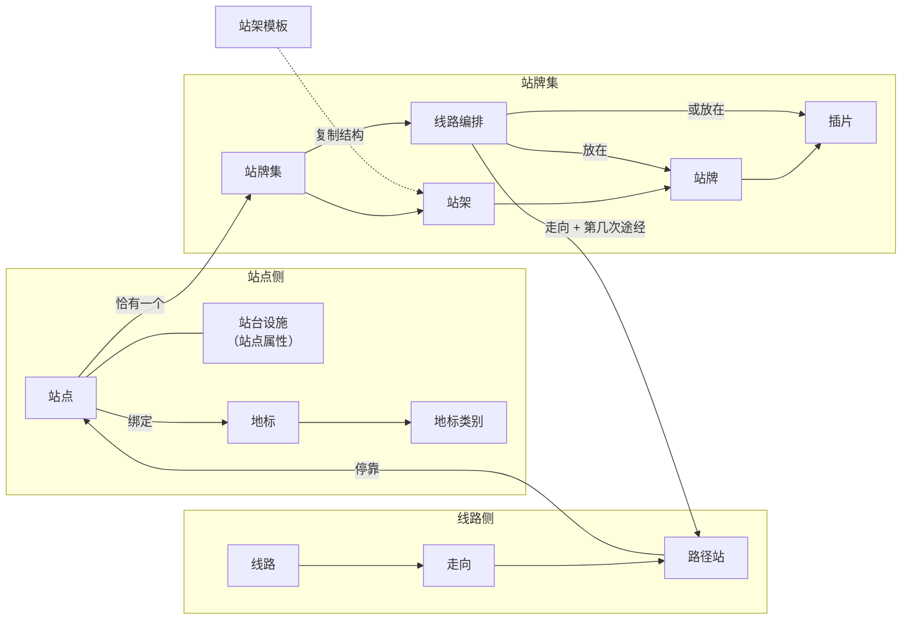

# GenTransit 需求分析

| 项 | 内容 |
|---|---|
| 日期 | 2026-10-27 |
| 状态 | 已确认（需求访谈四轮，决策 Q1–Q56；M0 原型定稿结论 Q57–Q68，2026-10-28 并入；见附录 A）。M1 已完成（2026-10-28） |
| 设计语言 | [docs/design-language.md](design-language.md)「导向 · 画室」；界面细节以它和 `prototype/` 为准 |
| 术语 | [GLOSSARY.md](../GLOSSARY.md)；本文所有业务名词以词表为准 |
| 决策 | [ADR 0001 独立重建为 TS 全栈](adr/0001-independent-ts-fullstack-rebuild.md)、[ADR 0002 不维护版本](adr/0002-no-versioning-json-snapshots.md)、[ADR 0003 单用户单城市](adr/0003-single-user-single-city.md) |
| 行为参考 | 旧后端 `E:\MiLu\code\route-info-board\rid-rs`，旧前端 `D:\Yiwer\code\sign-mgt-web`；只作为业务行为参考，不复用代码、不交换数据 |

---

## 1. 背景与目标

### 1.1 背景

旧平台（Route Info Board）围绕站点、线路、站牌集逐步生长出模板设计、渲染出图、制作调度、打印标记、快速打印、依据与结算、变更监控、版本日历、异步任务、LLM 导入等十余个模块。站点、线路、站牌集三类核心数据全部建立在版本链之上：每个版本是整个聚合的关系行拷贝，带生效日与失效日，几乎所有读写接口都带日期参数。版本链与派生缓存是旧系统复杂度和数据陈旧事故的主要来源。

### 1.2 目标

| 编号 | 目标 |
|---|---|
| G1 | 只维护三类主数据：站点、线路、站牌集，以及支撑它们的基础数据 |
| G2 | 去掉多版本：保存即生效；每次有效修改留存修改快照，可查看修改历史 |
| G3 | 重新设计视觉与交互语言，重建组件，提供舒适的使用体验 |
| G4 | 为下游（设计方、制作方、交通局、其他系统）提供 Excel 导出与只读 API 两条数据出口 |

### 1.3 非目标

- 不做模板设计、出图渲染、预览、站牌制作与调度。
- 不做预约生效、草稿审核、按日期回看、回滚。
- 不做多租户、多用户、角色权限、操作人审计。
- 不与旧系统做任何运行时交互或数据迁移，导入模板也不兼容旧系统格式。
- 不做手机端适配，不做多语言。

---

## 2. 范围

### 2.1 包含

| 模块 | 内容 |
|---|---|
| 工作台 | 待处理站牌集、最近修改、快捷新建 |
| 站点 | 站点信息、站台设施、照片、地标绑定、地图选点与列表地图联动、逆地理编码建议 |
| 线路 | 线路信息、走向、路径站、班次与到站时刻、运营/停运 |
| 站牌集 | 站架、站牌、插片、线路编排；编排状态实时计算；站牌集编辑器 |
| 地标 | 地标类别、地标及位置点、站点绑定与自动匹配候选 |
| 基础数据 | 7 类字典、行政区划（市/区/街道）、公交公司、站架模板 |
| 设置 | 账号与密码、API Token、方位模式、地标设置、扩展字段 |
| 修改历史 | 站点、线路、站牌集的修改快照与差异查看 |
| 数据进出 | 站点与线路的 Excel 导入导出；站牌集 Excel 导出；只读 REST API |

### 2.2 旧系统能力去向

| 旧能力 | 去向 |
|---|---|
| 版本链、生效日/失效日、版本分裂合并、按日期查询、版本切换器、生效日期弹窗与筛选 | 移除；保存即生效（ADR 0002） |
| 版本日历、视图版本汇总、变更类型标签、变更监控字段差异、操作日志 | 移除；由修改快照代替 |
| 线路暂停/临时停运/自动恢复（基于版本段） | 改为即时切换的"运营/停运"状态 |
| 线路无删除（以永久停运代替） | 新增"删除线路" |
| 站点 `status`（有效/无效）、`enabled`（只给制作用） | 移除；站点存在即在用 |
| 站牌集独立实体（仅含温馨提示与版本类型） | 站牌集作为站点下的整体保存单位，不能单独新建或删除 |
| 温馨提示按两个日期间路径站差异自动生成；站点与站牌集各一个提示字段 | 改为站牌集上的一段手填文字 |
| 站牌/插片的模板、背景色、内边距、模板参数、容量单元、12 位板码、排序号 | 移除 |
| 整版站牌中的非线路模板模块 | 移除 |
| 非线路插片（挂模板） | 保留插片类型，改为文字说明 |
| 编排"新增"标记、"修改"标记、"已标记" | 移除（依赖版本、依据、打印标记） |
| 待编排缓存表 `tb_board_calc_cache` 及维护函数 | 移除；读取时实时计算 |
| 走向折线、途经点、固定点、导航算路（GraphHopper）、站点方位检查 | 移除 |
| GeoServer 图层、Leaflet 备用引擎 | 移除；只用高德，站点点位前端绘制 |
| 地铁线路与地铁站 | 移除 |
| 地标 ①–⑤ 锁定类别顺序、地标 Excel 导入 | 移除 |
| 站点原站名、历史站名、原始经纬度、站点分组、站点标志图 | 移除 |
| 线路原名、历史线路名、核稿模板、线路模板类型、上下行站数、异构线、"外环"模式 | 移除（站数改为读取时计算） |
| 字典：图片标签、固定图片路径、待制作备注、线路模板类型 | 移除 |
| 城市专用站牌导入（福州、深圳、凯里）、通用站牌导入、照片批量导入、91bus 照片拉取 | 移除 |
| 模板、制作、智能制作、打印标记、快速打印、依据与结算、档案、LLM、异步任务、缓存刷新、概览图表、BIM 重建 | 整模块移除 |
| 多租户（按租户数据源 + RLS）、用户、角色、权限、外部认证同步 | 移除（ADR 0003） |
| 多语言（zh-CN / zh-TW / en-US） | 只保留简体中文 |
| 自动排序 | 保留规则，中文前缀改为拼音序，且不再丢弃失效编排 |
| 搜索历史、混合视图 | 移除 |

---

## 3. 使用者与部署形态

- **使用者**：一位业务维护人员，负责一个城市的站点、线路与站牌信息。
- **形态**：部署在一台服务器或内网机器上的 Web 应用，桌面浏览器访问。
- **数据边界**：一套部署只存一个城市的数据；服务多个城市时各自独立部署。
- **账号**：只有一个内置账号；没有注册、用户管理与角色。

---

## 4. 领域模型

### 4.1 概念关系

### 4.2 关键约束

1. 站点以"站名 + 方位"（编码模式下为"站名 + 编码"）唯一。
2. 每个站点恰有一个站牌集，随站点创建（初始为空）和删除。
3. 路径站引用站点；同一站点可在同一走向上出现多次，"第几次途经"按站序自然计算。
4. 线路编排以"走向 + 该走向第几次经过本站"定位一次途经，不使用路径站自身的 ID。
5. 一次途经要么隐藏，要么放在本站一块或多块站牌上（同一块站牌最多一次）。
6. 整版站牌没有插片，编排直接放在站牌上并有顺序；分片站牌的编排只能放在线路插片上，每个线路插片最多一条编排；非线路插片不放编排。
7. 站架模板只在套用时复制结构，站架不保留与模板的关联。
8. 修改快照的单位是站点、线路（含走向、路径站）、站牌集（含站架、站牌、插片、编排）。

---

## 5. 功能需求

### 5.1 通用交互

| 编号 | 需求 |
|---|---|
| F-COM-01 | 导航：工作台、站点、线路、站牌集、地标、基础数据（字典、行政区划、公交公司、站架模板）、设置（账号密码、API Token、方位模式、地标设置、扩展字段） |
| F-COM-02 | 列表筛选条件写入 URL，刷新、分享链接后保持；不提供搜索历史 |
| F-COM-03 | 表格可选择显示列与调整列顺序，选择结果在本浏览器记住 |
| F-COM-04 | 编辑页有未保存内容时，离开前提示 |
| F-COM-05 | 删除前二次确认，并写明连带影响（例如"删除站点会同时删除其站牌集"） |
| F-COM-06 | 多处同时编辑保护：保存时若对象在打开之后已被别处保存过，不覆盖，提示"已在别处修改"，可查看最新内容与差异后重新编辑 |
| F-COM-07 | 表单中引用字典的字段可直接新增字典项 |
| F-COM-08 | 主要操作可用键盘完成 |
| F-COM-09 | 站点、线路列表提供"已删除"视图，列出已删除对象（来自其最后一份快照），可查看其修改历史 |
| F-COM-10 | 外壳：不设顶栏；导航、全局搜索、主题切换、账号收进左侧窄栏 |
| F-COM-11 | 分栏：有空间属性的页面（站点列表 / 详情 / 表单、线路列表 / 详情 / 表单）左内容、右地图；分隔条可拖动，左栏最小 360px、最多占 62%；地图可收起、展开；宽度与收起状态记在本浏览器 |
| F-COM-12 | 分页：列表分页，每页 10 / 20 / 50 / 100 条（默认 20）；页码与每页条数写进 URL；筛选变化时回到第 1 页；地图只画当前页的对象，与列表一一对应 |
| F-COM-13 | 列表与地图联动：单击一项 = 在地图上定位并高亮，浮出小卡片，不跳页；双击或回车 = 进入详情页；鼠标悬停 = 地图上临时强调 |

### 5.2 工作台（首页）

- 待处理站牌集：有待编排或失效编排的站牌集数量，点击进入站牌集列表并带上"只看待处理"筛选。
- 最近修改：按时间倒序列出最近有修改快照的站点、线路、站牌集，可直接打开对象或其历史。
- 快捷新建：新建站点、新建线路。

### 5.3 站点

#### 5.3.1 字段

| 分组 | 字段 | 必填 | 规则 |
|---|---|---|---|
| 基本 | 站名 | 是 | ≤100 字 |
| 基本 | 方位 / 编码 | 是 | 方位模式：东、南、西、北、无、场站之一；编码模式：任意非空文本 |
| 基本 | 英文名 | | ≤100 字，只允许英文字母、数字、空格与常用标点 |
| 基本 | 经度、纬度 | 是 | 存 GCJ-02 |
| 基本 | 市 / 区 / 街道 | | 引用行政区划，三级联动 |
| 基本 | 路段 | | 字典 |
| 基本 | 二维码 URL | | ≤500 字 |
| 基本 | 地标 | | 绑定若干地标，数量不超过"单站绑定上限" |
| 站台设施 | 泊位数 | | 非负整数 |
| 站台设施 | 站台类型 | | 字典 |
| 站台设施 | 安全设施 | | 字典 |
| 站台设施 | 候车设施 | | 文本（旧系统字段 `queuing_facility`） |
| 站台设施 | 候车亭类型 | | 字典 |
| 站台设施 | 大灯箱数、小灯箱数、座椅数 | | 非负整数 |
| 其他 | 维护公司 | | 字典 |
| 其他 | 备注 | | ≤500 字 |
| 其他 | 照片 | | 最多 10 张 |
| 各分组 | 扩展字段 | 按字段定义 | 站点扩展字段可指定显示在"基本 / 站台设施 / 其他"分区 |

派生信息（只读、实时计算，不进快照）：经过本站的线路及数量。

#### 5.3.2 列表

- 布局：列表 + 地图分栏（F-COM-11）。左栏窄时每行显示站名、方位章、经过线路的线路牌与待处理标记；左栏不小于 760px 时切换为宽表。地图画当前页站点（F-COM-12），选中站点在地图右下角浮出摘要卡片，可打开详情或编辑。
- 宽表列：站名、方位、英文名、经过线路、线路数、经纬度、市区街道、路段、地标、维护公司、备注、最近修改时间、扩展字段。
- 筛选：名称（联想）、方位、市区街道、路段、经过的线路、维护公司。
- 操作：新建、编辑、查看详情、查看历史、删除、导入、导出（当前筛选结果）。

#### 5.3.3 新建与编辑

- 布局：左侧属性表（基本、站台设施、其他、地标、照片分节；标签在左、取值在右，输入框平时像文字，悬停或聚焦才显出边框），右侧地图（F-COM-11）。底部固定状态栏，显示"未保存：改了哪些字段"和保存按钮。
- 地图上点选或拖动标记更新坐标；手工输入坐标时标记同步移动。
- 选点后调用高德逆地理编码，给出市、区、街道、路段的建议值；用户确认后才填入，已填写的值不被自动覆盖。
- 地标区：显示按辐射半径自动匹配出的候选地标（若"自动匹配"开启），用户逐个确认绑定；也可手动搜索绑定。
- 站名 + 方位重复时即时提示。
- 新建保存后可直接进入该站点的站牌集编辑器。

#### 5.3.4 详情

- 独立页面，左内容、右地图（F-COM-11）。
- 顶部：返回链接；修改历史按钮（见 5.9）、编辑、站牌集；更多菜单里放删除。
- 标题区：站名（衬线大字）、方位章、英文名、市区街道与路段。
- 分节：经过线路（线路牌，可复制；悬停时地图上强调该走向并显示行驶方向）、站牌集摘要（站架数、站牌数与尺寸、待编排与失效数，可进入编辑器）、位置、地标、站台设施、其他信息与扩展字段、照片。

#### 5.3.5 删除

- 仍有路径站引用该站点时禁止删除，并列出引用它的线路与走向。
- 删除时同时删除其站牌集；站点与站牌集各存一份"删除"快照。

### 5.4 线路

#### 5.4.1 字段

**线路**

| 字段 | 必填 | 规则 |
|---|---|---|
| 线路名 | 是 | ≤100 字，唯一 |
| 管理编号 | 是 | 唯一 |
| 英文名 | | |
| 线路模式 | 是 | 单向、双边、单环、双环 |
| 公交公司 | | 引用公交公司 |
| 售票类型 | | 有人售票 / 无人售票 |
| 票制 | | 字典 |
| 票价 | | ≤50 字文本 |
| 状态 | 是 | 运营 / 停运，默认运营 |
| 扩展字段 | 按字段定义 | |

**走向**：由线路模式决定数量与名称——单向、单环各一个走向；双边为上行、下行；双环为内环、外环。

| 字段 | 规则 |
|---|---|
| 服务类型 | 定时班车 / 发车间隔 |
| 服务时间 | ≤1000 字 |
| 发车间隔 | ≤500 字 |
| 站序 | 有序的路径站列表 |

**路径站**

| 字段 | 规则 |
|---|---|
| 站点 | 引用站点 |
| 序号 | 由站序位置决定 |
| 第几次途经 | 派生：本走向中该站点第几次出现 |
| 到站时刻 | 若干个时刻（HH:mm） |
| 扩展字段 | 按路径站扩展字段定义 |

派生信息（只读）：各走向起点站与终点站（取首末路径站的站名）、各走向站数、经过站点。

#### 5.4.2 列表

- 布局：列表 + 地图分栏（F-COM-11）。线路名一律以线路牌显示；悬停或单击一行时地图上强调该线路走向（F-COM-13）。
- 列：线路名、管理编号、英文名、模式、状态、起终点、各走向站数、公交公司、售票类型、票制、票价、最近修改时间、扩展字段。
- 默认排序采用自动排序规则（5.5.6）。
- 筛选：名称、模式、公司、状态、经过的站点。
- 操作：新建、编辑、查看详情、查看历史、停运 / 恢复运营、删除、导入、导出（当前筛选结果）。

#### 5.4.3 新建与编辑

- 布局：左侧表单（线路属性 + 各走向分页签），右侧地图（F-COM-11），按站序把当前走向的站点连线显示并标出行驶方向，其他走向淡显。
- 站序编辑：添加站点（按站名 + 方位搜索）、拖拽排序、删除、清空；支持粘贴两列文本（站名、方位）批量追加，匹配不到的站点逐条标出。
- 班次编辑器：按路径站编辑到站时刻；支持给定首站时刻与间隔自动填充。
- 路径站扩展字段在站序表中编辑。
- 停运线路也可编辑。
- 修改线路模式导致某个走向消失时，保存前提示该走向在各站牌集里的编排会被删除。

#### 5.4.4 停运与恢复

- 停运与恢复立即生效，不支持指定日期或自动恢复。
- 停运线路的走向视为不经过任何站点：其编排在各站牌集显示为失效，各站不再出现它的待编排；恢复运营后，这些编排自动回到已编排或隐藏。

#### 5.4.5 删除

- 删除线路时同时删除其全部编排；受影响的每个站牌集各存一份快照，动作为"连带修改"，说明如"删除线路 K1 路，连带移除编排"。
- 线路自身存一份"删除"快照。

#### 5.4.6 详情

- 独立页面，左内容、右地图（F-COM-11）。
- 顶部：返回链接；修改历史按钮（见 5.9）、编辑、停运 / 恢复运营；更多菜单里放删除。
- 标题区：大号线路牌、英文名、模式与状态、公交公司；线路属性用属性表。
- 走向切换（分段控件）：每个走向显示服务类型、服务时间、发车间隔卡片和站序条形图。
- 站序条形图：竖向轨道，首末站实心、中间站空心；每站右侧列出可换乘线路的线路牌。单击一站 = 地图定位到该站并浮出卡片（卡片上可进入站点详情），不跳页；双击或回车 = 进入站点详情（F-COM-13）。
- 停运 / 恢复前弹窗确认，写明影响：涉及多少个站点的站牌集，其上编排将显示为失效（或恢复）。

### 5.5 站牌集

#### 5.5.1 字段

**站牌集**：温馨提示（手填文字，≤1000 字）。

**站架**

| 字段 | 必填 | 规则 |
|---|---|---|
| 站架类型 | 是 | 字典 |
| 编号 | 是 | 站牌集内唯一，1–15，以中文数字显示 |
| 名称 | | |
| 说明 | | |
| 无实物站架 | | 布尔，默认否 |
| 材质说明 | | |
| 排列顺序 | 是 | 站牌集内的显示顺序 |

**站牌**

| 字段 | 必填 | 规则 |
|---|---|---|
| 所在站架 | 是 | |
| 面 | 是 | 正面、背面、A–F 面 |
| 类型 | 是 | 整版 / 分片 |
| 编号 | 是 | 站牌集内唯一，1–90，以中文数字显示 |
| 宽、高 | 是 | 毫米，正整数 |
| 备注 | | |

**插片**（仅分片站牌）

| 字段 | 必填 | 规则 |
|---|---|---|
| 编号 | 是 | 所在站牌内唯一 |
| 类型 | 是 | 线路插片 / 非线路插片 |
| 非线路说明 | 非线路插片必填 | 如"广告位""公告栏" |
| 宽、高 | 是 | 毫米，正整数 |

**线路编排**

| 字段 | 规则 |
|---|---|
| 走向 + 第几次途经 | 定位本站的一次途经 |
| 放置 | 某块整版站牌 / 某个线路插片 / 隐藏 |
| 顺序 | 同一整版站牌内的展示顺序 |

#### 5.5.2 编排状态

| 状态 | 判定 | 是否存储 |
|---|---|---|
| 已编排 | 有放在站牌或插片上的编排，且走向仍经过本站 | 存储放置 |
| 隐藏 | 有隐藏编排，且走向仍经过本站 | 存储 |
| 待编排 | 运营中线路的走向经过本站，但没有任何编排 | 实时计算 |
| 失效编排 | 有编排，但走向已不再经过本站（站序调整、线路停运） | 实时计算 |

- "走向经过本站"指：线路运营中，且走向站序中包含本站点的第 N 次途经。
- 失效编排保留，可单条或一键清理；走向重新经过本站后自动恢复。
- 走向被删除（删除线路或修改模式）时，其编排直接删除。

#### 5.5.3 站牌集编辑器

版式为"站台立面 + 线路托盘"（M0 定稿 A3）：

- **顶部**：站名与方位章、待编排 / 失效计数、修改历史按钮、撤销修改、保存。
- **站台立面（上方主区）**：
  - 站架从左到右排开，按页面宽度自动折行，可多行展示。
  - 站牌、插片按实际宽高（毫米）同一比例绘制；比例分紧凑、标准、大三档，记在本浏览器。
  - 候车亭画顶棚，立柱和地面线表示安装方式；站架下方标注编号、类型与名称。
  - 站牌是"实物"样式：金属边框、牌头（编号、面、类型与线路数）、线路行。行内容按牌面宽度分三级：窄只显示线路牌与方向；中加终点站；宽再加序号与"开往"。
  - 分片站牌画出各插片，插片左上角标号码；非线路插片用斜纹并显示说明。
  - 失效编排在站牌上以失效样式（陶土色、删除线）原位显示；工具条提供"清理 N 条失效编排"。
- **线路托盘（下方）**：只有两个区，已编排的看站牌本身，不在托盘重复列出。
  - 待编排：本站尚无编排的途经，每条显示线路牌、走向、开往。往上拖到站牌或插片即放置；把站牌上的线路拖回这里即移除该编排（该途经若无其他编排则回到待编排）。
  - 隐藏：独立的虚线投放区。拖进去即隐藏，同时移除该途经在本站的所有放置；可拖回待编排或点"取消隐藏"恢复。
  - 托盘可收起，腾出高度看多行站架。
- **放置线路**：拖拽到站牌或插片；或在线路的菜单中选"放到…"选择目标（所有拖拽都有不拖拽的替代）。
- **整版站牌内排序**：拖拽排序，或"自动排序"。
- **复制编排**：在站牌上线路行的菜单中选"复制到…"，放到本站另一块站牌。
- **隐藏**：拖入隐藏区，或在菜单中选择"隐藏"。
- **属性卡**：选中站架、站牌或插片时，右上角浮出属性卡编辑其字段。
- **结构编辑**：
  - 添加站架：空白添加，或选择站架模板添加一个或多个（编号自动取下一个可用值）。
  - 重新套用模板：替换该站架下的站牌与插片结构，原站牌上的线路回到待编排；执行前确认。
  - 编辑站架、站牌、插片属性；在整版与分片之间切换站牌类型。
  - 删除站架、站牌或插片时，其上的编排删除；若该途经在其他站牌仍有编排则保持已编排，否则回到待编排。
- **温馨提示**：在编辑器中编辑。
- **保存**：整页一次保存，与快照单位一致；未保存离开提示；存在分片站牌没有任何线路插片等异常时保存前提示确认。

#### 5.5.4 站牌集列表

- 列：站点名称、方位、经过线路、市区街道、路段、站架数与类型、站牌数与尺寸、待编排数、失效数、最近修改时间。
- 筛选：站点、街道、路段、线路、站架类型、站牌尺寸、只看待处理（有待编排或失效编排）。
- 点击站点名称打开只读抽屉预览；操作"编排"进入编辑器；导出当前筛选结果。

#### 5.5.5 只读预览

抽屉中展示与编辑器一致的站台立面与线路，不可编辑，可跳转编辑器、站点详情。

#### 5.5.6 自动排序规则

用于整版站牌内"自动排序"、线路池排序和线路列表默认排序。

1. 线路名拆为三段：前缀（开头的非数字部分）、数字（第一段连续数字）、后缀（其余部分）。
2. 空线路名排在最后。
3. 都含数字时：无前缀的排在有前缀的前面；前缀不同按前缀拼音序；前缀相同按数字大小；数字也相同按后缀拼音序。
4. 都不含数字时：按线路名拼音序。
5. 不含数字的线路名 A 与含数字的线路名 B 比较：若 B 无前缀，B 在前；若 A 等于 B 的前缀，A 在前；否则按 A 与 B 的前缀拼音序。
6. 自动排序只调整顺序，不删除任何编排。

示例：`1路、2路、10路、夜1路、B1路、B2路、K、K1路、K12路`。拼音序采用 ICU 中文排序规则（前端 `Intl.Collator` 与数据库 `COLLATE "zh-x-icu"` 一致），它把汉字排在拉丁字母之前，所以前缀"夜"排在"B""K"之前。

### 5.6 地标

- **地标类别**：名称（必填，唯一）、图标、默认辐射半径（米）、启用。停用的类别其地标不参与绑定候选。
- **地标**：名称（必填）、英文名、类别（必填）、位置点（至少一个，每个点有经纬度与辐射半径，半径默认取类别值）。
- **页面**：地图 + 列表，地图上显示地标位置点与辐射范围；可按类别、名称筛选。
- **绑定**：站点表单中手动绑定，或从自动匹配候选中确认；候选规则为站点坐标落在地标任一位置点的辐射半径内。
- **设置**：单站绑定上限；是否启用自动匹配候选。

### 5.7 基础数据

| 数据 | 字段与规则 |
|---|---|
| 字典 | 七类：站架类型、维护公司、路段、票制、站台类型、安全设施、候车亭类型；每项一个名称，同类内唯一 |
| 行政区划 | 市 → 区 → 街道三级，名称在上级内唯一 |
| 公交公司 | 名称（必填，唯一）、英文名、简称、logo、服务热线；显示关联线路数 |
| 站架模板 | 名称（必填）、站架类型（必填）、说明、无实物站架、示意图（可选）、站牌结构（每块：面、类型、宽高、备注；分片站牌含插片：编号、类型、非线路说明、宽高）；列表按站架类型分组 |

- 字典项、行政区划、公交公司、地标、地标类别：被引用时不能删除，只能改名；改名后所有引用处显示新名称。
- 站架模板随时可删除，已生成的站架不受影响。

### 5.8 设置

| 设置项 | 内容 |
|---|---|
| 账号 | 查看用户名，修改密码（需输入原密码） |
| API Token | 新建（填写名称，明文只在创建时显示一次）、列表（名称、创建时间、最后使用时间）、吊销 |
| 方位模式 | 方位模式 / 编码模式（见 BR-13） |
| 地标设置 | 单站绑定上限、是否启用自动匹配候选 |
| 扩展字段 | 见 5.8.1 |

#### 5.8.1 扩展字段

- 归属：站点、线路、路径站。
- 定义：字段名、键（同归属内唯一）、类型（文本、下拉、数字、日期、时间、文本列表）、下拉选项、说明；站点字段另有显示分区（基本 / 站台设施 / 其他）。
- 字段名在同归属内唯一；字段已有值后类型不可修改。
- 只能停用，不能删除；停用后表单与列表不再显示，已有值保留，可恢复启用。
- 扩展字段参与列表显示、导入导出与 API 输出。

### 5.9 修改快照与修改历史

| 项 | 规则 |
|---|---|
| 快照对象 | 站点；线路（含走向、路径站）；站牌集（含站架、站牌、插片、编排、温馨提示） |
| 触发动作 | 新增、修改、删除、导入新增、导入修改、连带修改（附说明） |
| 有效修改 | 规范化后的内容与上一份快照不同时才存；内容相同的保存不产生快照 |
| 自包含 | 快照中引用的站点、线路、字典项、行政区划、公交公司、地标、扩展字段定义，连同当时的名称一起存入 |
| 不含 | 派生信息（待编排、失效、经过线路、站数）与修改时间等元数据 |
| 记录 | 时间、动作、说明、完整 JSON；不记操作人 |
| 范围 | 不扩散：站点改名、字典项改名、线路停运、站序调整都不给其他对象生成快照；只有删除线路、修改线路模式删除走向时，给受影响的站牌集生成"连带修改"快照；批量导入时每个受影响对象各一份 |
| 查看 | 详情页与编辑器顶部是"修改历史"按钮（显示快照数量），点开为弹窗时间轴，每个对象一条；每份快照显示时间、动作、说明，可展开与上一份的字段级差异（旧值删除线、新值高亮），列表类内容（路径站、站架、站牌、编排）显示增、删、移动、修改 |
| 保留 | 永久保留，不自动清理；对象删除后历史仍可查看（F-COM-09） |
| 不支持 | 回滚、恢复、按日期回看、对外 API 输出 |

### 5.10 导入

#### 5.10.1 通用流程

1. 下载模板（含当前启用的扩展字段列）。
2. 上传文件（站点导入需选择坐标系）。
3. 预览：新增、修改（标出改动字段或站序差异）、失败（写明原因）三栏；站点导入另有"将新建的字典项"一栏。
4. 确认后写入；可取消；失败行可下载。
5. 导入不删除任何对象。
6. 每个新增或修改的对象各生成一份快照（导入新增 / 导入修改）。

#### 5.10.2 站点导入

- 列：站名*、方位*、英文名、经度、纬度、市、区、街道、路段、维护公司、备注、二维码 URL、站台设施 8 项、站点扩展字段（每个一列）。
- 坐标系：GCJ-02、BD-09、WGS-84，统一转换为 GCJ-02。
- 匹配：按"站名 + 方位"，存在则修改，不存在则新增。
- 修改时空单元格表示该项不改。
- 不存在的字典项与行政区划：在预览中列出，确认导入时一起新建。
- 照片、地标不通过导入维护。

#### 5.10.3 线路导入

| sheet | 列 |
|---|---|
| 线路 | 管理编号*、线路名*、英文名、模式*、公交公司、售票类型、票制、票价、状态、线路扩展字段 |
| 走向 | 管理编号*、走向*、服务类型、服务时间、发车间隔 |
| 路径站 | 管理编号*、走向*、序号*、站名*、方位*、到站时刻、路径站扩展字段 |

- 按管理编号匹配线路，存在则修改，不存在则新增。
- 文件中出现的走向，站序整体替换为文件内容；未出现的走向不变。
- 路径站按"站名 + 方位"匹配站点；任一站点匹配不上则整条线路失败，不自动新建站点；预览中列出所有未匹配站点。
- 走向名称须与线路模式一致（双边：上行/下行；双环：内环/外环；单向、单环：唯一走向）。

### 5.11 导出

- 站点导出、线路导出的格式与对应导入模板完全一致，导出文件修改后可直接再导入；原样导入时预览应为零修改。
- 导出范围为当前列表筛选结果。
- 站牌集导出：一个 Excel，四个 sheet，每行带站名与方位定位站点：

| sheet | 列 |
|---|---|
| 站架 | 站名、方位、站架编号、站架类型、名称、说明、无实物站架、材质说明、排列顺序 |
| 站牌 | 站名、方位、站架编号、站牌编号、面、类型、宽、高、备注 |
| 插片 | 站名、方位、站牌编号、插片编号、类型、非线路说明、宽、高 |
| 线路编排 | 站名、方位、线路名、走向、第几次途经、站牌编号、插片编号、顺序、状态（已编排 / 隐藏 / 失效） |

- 站牌集导出格式按将来可回导设计；首版不做站牌集导入。

### 5.12 只读 API

- 风格：REST + JSON，自动生成 OpenAPI 文档。
- 鉴权：`Authorization: Bearer <API Token>`；只读，任何写操作不可用。
- 资源：

| 资源 | 内容 |
|---|---|
| 站点 | 列表与详情（含站台设施、地标、扩展字段、照片地址） |
| 线路 | 列表与详情（含走向、路径站、到站时刻） |
| 站牌集 | 按站点查询（含站架、站牌、插片、编排与状态、温馨提示） |
| 地标、地标类别 | 列表与详情 |
| 字典、行政区划、公交公司 | 列表 |
| 已删除对象 | 按时间返回类型、ID、名称、删除时间 |
| 文件 | 照片、logo、模板示意图，需 Token 访问 |

- 列表支持分页与 `updatedSince`（只取该时间之后有变化的对象）。站牌集的"有变化"包括其自身修改，以及因线路变化导致的编排状态变化。
- 不输出修改快照。

---

## 6. 业务规则汇总

| 编号 | 规则 |
|---|---|
| BR-01 | 保存即生效，不存在未来生效或过去补录 |
| BR-02 | 站点"站名 + 方位"唯一；线路名唯一；管理编号唯一 |
| BR-03 | 新建站点自动拥有一个空站牌集；站牌集不能单独新建或删除 |
| BR-04 | 被路径站引用的站点不能删除；删除站点连带删除其站牌集 |
| BR-05 | 编排以"走向 + 第几次途经"定位 |
| BR-06 | 一次途经要么隐藏，要么放在一块或多块站牌上，同一站牌最多一次 |
| BR-07 | 整版站牌无插片；分片站牌的编排只进线路插片，每个线路插片最多一条；非线路插片不放编排 |
| BR-08 | 待编排与失效编排实时计算，不建缓存 |
| BR-09 | 停运线路的走向视为不经过任何站点；恢复后编排自动恢复 |
| BR-10 | 走向被删除（删线路、改模式）时其编排删除，受影响站牌集生成连带修改快照 |
| BR-11 | 有效修改才生成快照；快照自包含、永久保留、不可回滚 |
| BR-12 | 被引用的字典项、行政区划、公交公司、地标、地标类别不能删除；扩展字段只能停用 |
| BR-13 | 方位模式 → 编码模式可随时切换，原值作为文本保留；编码模式 → 方位模式，仅当全部站点的值都属于东、南、西、北、无、场站时允许，否则列出不符合的站点 |
| BR-14 | 站架模板套用时复制结构，不保留关联 |
| BR-15 | 自动排序只调整顺序，不删除编排；中文按拼音序 |
| BR-16 | 导入不删除对象；修改时空单元格表示不改 |
| BR-17 | 线路导入中任一站点匹配失败则整条线路失败 |
| BR-18 | 保存时检测对象是否已在别处被保存，冲突时不覆盖 |

---

## 7. 非功能需求

### 7.1 规模与性能

| 项 | 目标 |
|---|---|
| 设计规模上限 | 站点 2 万、线路 3000、站架 5 万、站牌 10 万 |
| 列表查询、保存 | 1 秒内完成 |
| 地图 | 列表页地图画当前页对象（每页至多 100 个，F-COM-12）；平移缩放不卡顿 |
| 导入 | 1 万行文件 1 分钟内完成预览 |
| 编排状态计算 | 站牌集列表的待编排、失效计数在上述规模下仍满足 1 秒目标 |

### 7.2 安全

- 密码以安全哈希存储；初始用户名与密码来自环境变量，首次登录后可修改。
- 会话使用 httpOnly、SameSite Cookie；连续登录失败后限流。
- API Token 只存哈希，可吊销，记录最后使用时间。
- 高德 JS API Key 在控制台绑定域名白名单；安全密钥（securityJsCode）与 Web 服务 Key 只在服务端环境变量中，由服务端代理调用，浏览器不可见。
- 上传文件限制类型与大小，访问需登录会话或 API Token。

### 7.3 部署与运维

- Docker Compose 单机部署：PostgreSQL 容器 + NestJS 容器（同时托管 React 静态资源）。
- 上传文件存放在挂载卷。
- 每日 pg_dump 备份数据库，同时备份上传目录，保留 30 天；提供恢复步骤说明。
- 配置全部通过环境变量提供，至少包括：数据库连接、初始账号、会话密钥、高德 JS Key（`AMAP_JSAPI_KEY`）、高德 JS API 安全密钥（`AMAP_JSAPI_SECURITY_CODE`）、高德 Web 服务 Key（`AMAP_WEB_SERVICE_KEY`）、上传目录、备份保留天数。完整变量名见仓库根目录 `.env.example`。
- 高德安全密钥只在服务端使用：JS API 的服务请求经服务端 `/_AMapService` 代理转发并附加 `jscode`，前端只配置 `serviceHost`（M0 原型已按此实现并验证）。

### 7.4 体验与设计原则

- 桌面优先，最小宽度 1280px；支持最新版 Chrome 与 Edge。
- 表格、表单偏紧凑，用层级、分组与留白降低视觉负担。
- 浅色为主，支持深色。
- 视觉与交互遵循设计语言「导向 · 画室」（[design-language.md](design-language.md)）：暖纸底色 + 墨色文字，墨绿用于主操作与线路牌；凡出现线路名一律用线路牌；属性表代替表单。
- 编排状态语义固定，颜色同时配文字或形状：待编排 = 赭石 + 呼吸点；已编排 = 鼠尾草；隐藏 = 虚线框；失效 = 陶土 + 删除线。
- 高德底图使用浅色 / 深色样式，只显示底色、道路、建筑，并加暖色滤镜融入纸面色调；站点、线路、选中标记由前端自绘覆盖层绘制；高德 logo 与版权信息保持可见。
- 动效只出现在关键瞬间（保存成功、需要注意、等待、表示方向），系统开启"减少动效"时停止。
- 界面只用简体中文，不接 i18n。
- 可点击原型（M0）已确认视觉与交互方向，代码在 `prototype/`，只作参考，不进入正式工程。

---

## 8. 技术方案约束

| 层 | 选择 |
|---|---|
| 仓库 | pnpm monorepo：前端应用、后端应用、共享包 |
| 前端 | React + Vite（SPA）、React Router、TanStack Query、react-hook-form + zod、shadcn/ui（Radix + Tailwind）、TanStack Table、dnd-kit、高德 JS API |
| 后端 | NestJS + Prisma |
| 数据库 | PostgreSQL |
| 测试 | 后端 Jest 单元测试 + Testcontainers 真实 PostgreSQL 集成测试；前端 Vitest 组件测试 + Playwright 端到端测试 |

---

## 9. 验收场景

| 编号 | 场景 | 期望 |
|---|---|---|
| AC-01 | 新建站点 X | X 拥有空站牌集；生成站点"新增"快照 |
| AC-02 | 线路 L 上行站序加入 X 并保存 | X 的站牌集出现 L 上行的待编排；工作台待处理数加一 |
| AC-03 | 将 L 上行放到 X 的整版站牌 1 并保存 | 状态变为已编排；X 的站牌集生成一份快照 |
| AC-04 | 不做任何改动再次保存 X 的站牌集 | 不生成新快照 |
| AC-05 | 停运线路 L | X 上 L 的编排显示失效；L 不出现在待编排；X 的站牌集不生成快照 |
| AC-06 | 恢复线路 L | X 上 L 的编排恢复为已编排 |
| AC-07 | 删除线路 L | 所有站牌集中 L 的编排被删除，每个受影响站牌集各一份"连带修改"快照；L 出现在线路"已删除"视图并可查看历史 |
| AC-08 | 环线两次经过站点 Y | Y 的站牌集出现两条独立途经，可分别编排 |
| AC-09 | 删除仍被路径站引用的站点 | 被拒绝，并列出引用它的线路与走向 |
| AC-10 | 两个标签页编辑同一站点，先后保存 | 后保存的一方收到冲突提示，不覆盖前者 |
| AC-11 | 导出站点后原样导入 | 预览新增 0、修改 0 |
| AC-12 | 线路导入中有一个路径站的站点不存在 | 该线路整条失败，预览列出未匹配站点，其他线路照常 |
| AC-13 | 站点导入出现库中没有的路段 | 预览"将新建的字典项"列出该路段，确认后新建 |
| AC-14 | 编码模式下存在值为"A1"的站点时切回方位模式 | 被拒绝，并列出不符合的站点 |
| AC-15 | 对整版站牌执行自动排序 | 线路按 5.5.6 规则排序，失效编排仍保留 |
| AC-16 | 修改双边线路为单向 | 保存前提示下行编排将被删除；确认后受影响站牌集生成连带修改快照 |
| AC-17 | 用 API Token 调用站点列表并带 `updatedSince` | 只返回该时间之后有变化的站点；吊销 Token 后调用失败 |
| AC-18 | 浏览器网络请求中检查高德安全密钥 | 不出现安全密钥与 Web 服务 Key |

---

## 10. 里程碑

| 阶段 | 内容 | 完成标志 |
|---|---|---|
| M0 ✅ | 可点击原型与设计语言（站点列表、站点表单、站牌集编辑器为重点） | 视觉方向确认（2026-10-28 完成；结论见附录 A Q57–Q68 与 [prototype/README.md](../prototype/README.md)） |
| M1 ✅ | 工程骨架；登录；修改快照机制；字典、行政区划、公交公司；站点（含地图、地标、逆地理编码）；设置中的账号、方位模式、地标设置、扩展字段 | AC-01、AC-09、AC-10、AC-14 通过；站点保存满足有效修改判定（AC-04 的同一规则）。2026-10-28 完成；计划与完成记录见 [planning/2026-10-28-m1-plan.md](planning/2026-10-28-m1-plan.md) |
| M2 | 线路（走向、站序、班次与到站时刻、停运、删除）；站点与线路的导入导出 | AC-11、AC-12、AC-13 通过 |
| M3 | 站牌集编辑器；站架模板；站牌集列表、预览与导出；工作台 | AC-02 至 AC-08、AC-15、AC-16 通过 |
| M4 | 只读 API 与 API Token；Docker 部署与备份 | AC-17、AC-18 通过；完成一次备份恢复演练 |

快照机制放在 M1，是因为之后每个模块都依赖它。

---

## 11. 默认处理与待细化项

以下细节访谈中未逐条讨论，先按默认处理，实现前可调整：

| 项 | 默认 |
|---|---|
| 站点坐标是否必填 | 必填（地图联动与地标匹配都依赖坐标） |
| 走向最少路径站数 | 2 个 |
| 管理编号格式 | 不限格式，≤50 字 |
| 照片单张大小与格式 | ≤10 MB，jpg / png / webp |
| 登录失败限流 | 连续 5 次失败后 15 分钟内拒绝登录 |
| 站架编号、站牌编号上限 | 沿用 15、90 作为硬上限 |
| 字典项排序 | 按名称拼音序 |
| 站牌集 `updatedSince` 的"有变化" | 包含因线路变化（站序、停运、删除）引起的编排状态变化，否则下游增量同步会漏掉失效与待编排的变化 |

---

## 附录 A 决策记录

| 编号 | 主题 | 决定 |
|---|---|---|
| Q1 | 交付形态 | 独立新项目，TS 全栈 |
| Q2 | 新旧系统关系 | 相互独立，不做数据交互 |
| Q3 | 领域模型基线 | 沿用现有概念做减法，吸收个别低成本改进 |
| Q4 | 移除多版本 | 只存当前数据，保存即生效，不引入替代机制 |
| Q5 | 修改留痕 | 有效修改即保留 JSON 快照，可查看修改历史 |
| Q6 | 多租户 | 不保留，单用户 |
| Q7 | 线路编排 | 属于站牌信息维护；去掉模板与出图字段 |
| Q8 | 前端 | React，重新设计视觉与交互，重建组件 |
| Q9 | 后端 | NestJS + Prisma，pnpm monorepo |
| Q10 | 部署 | 服务器 Web 应用，单内置账号，单城市 |
| Q11 | 数据去向 | 系统内查询 + Excel 导出 + 只读 API |
| Q12 | 初始数据 | 不直连旧库；站点、线路 Excel 导入；不兼容旧格式；站牌集首版不导入 |
| Q13 | 地图 | 只用高德；去掉 GeoServer、GraphHopper、走向折线；坐标存 GCJ-02；密钥在环境变量 |
| Q14 | 快照规则 | 三类对象整体快照、有效修改判定、自包含、不扩散、不可回滚 |
| Q15 | 站牌集与站牌 | 站牌集为站点下整体；"站牌"只指单块牌；站台设施属于站点 |
| Q16 | 编排定位 | "走向 + 第几次途经"，不用路径站 ID |
| Q17 | 不再经过时 | 编排保留为失效，可清理，自动恢复；走向删除则编排删除；实时计算 |
| Q18 | 线路停运与删除 | 即时停运/恢复；新增删除线路 |
| Q19 | 站点状态 | 去掉状态与启用字段；被引用不可删；连带删除站牌集 |
| Q20 | 非线路内容 | 保留非线路插片 + 文字说明；去掉整版非线路模块与容量单元 |
| Q21 | 扩展字段 | 保留站点、线路、路径站扩展字段 |
| Q22 | ADR | 记 0001、0002 |
| Q23 | React 形态 | Vite SPA + React Router + TanStack Query + react-hook-form/zod |
| Q24 | 组件库 | shadcn/ui + TanStack Table + dnd-kit |
| Q25 | 设计原则 | 桌面优先 1280px、偏紧凑、浅色为主支持深色、固定状态色、交互底线、先做原型 |
| Q26 | 站牌集编辑器 | 线路池 + 比例结构图 + 拖拽或"放到…" + 自动排序 + 复制 + 整页保存 |
| Q27 | 数据库与部署 | PostgreSQL；Docker Compose；挂载卷；每日备份保留 30 天 |
| Q28 | 登录与 API 鉴权 | 单账号 + httpOnly Cookie + 限流；只读 API Token |
| Q29 | API 范围 | REST + OpenAPI；分页、updatedSince、已删除对象；不输出快照 |
| Q30 | 高德密钥 | Key 绑定域名；安全密钥服务端代理 |
| Q31 | 站架/站牌/插片属性 | 见 5.5.1；去掉模板、背景色、内边距、模板参数、容量单元、板码、排序号 |
| Q32 | 站架模板 | 保留结构模板，按类型分组，一键套用与重新套用 |
| Q33 | 温馨提示 | 站牌集上一段手填文字 |
| Q34 | 班次与时刻 | 保留走向服务信息与路径站到站时刻 |
| Q35 | 地标 | 保留类别、地标、位置点、绑定与自动匹配候选、单站上限；去掉 ①–⑤、导入、GeoServer 图层 |
| Q36 | 地铁 | 删除 |
| Q37 | 图片与文件 | 站点照片、公司 logo、模板示意图；去掉站点标志图；二维码只存 URL |
| Q38 | 字典 | 保留 7 类 + 行政区划 + 公交公司；去掉 4 类 |
| Q39 | 站点字段 | 见 5.3.1 |
| Q40 | 线路字段 | 见 5.4.1；起终点取首末站；停运可编辑 |
| Q41 | 列表与查询 | 见 5.3.2、5.4.2、5.5.4；去掉混合视图与搜索历史 |
| Q42 | ADR | 记 0003 |
| Q43 | 站点导入 | 见 5.10.2 |
| Q44 | 线路导入 | 见 5.10.3 |
| Q45 | 导出 | 见 5.11 |
| Q46 | 自动排序 | 保留规则，中文拼音序，不删编排 |
| Q47 | 删除与保留 | 被引用不可删只可改名；模板随时可删；快照永久保留 |
| Q48 | 并发保护 | 保存冲突检测，不覆盖 |
| Q49 | 逆地理编码 | 选点后给建议值，确认后填入 |
| Q50 | 导航与首页 | 见 F-COM-01 与 5.2 |
| Q51 | 规模与性能 | 见 7.1 |
| Q52 | 测试策略 | 见第 8 节 |
| Q53 | 里程碑 | 见第 10 节 |
| Q54 | 文档形式 | 本文件 |
| Q55 | 删线路连带快照 | 受影响站牌集各存一份连带修改快照 |
| Q56 | 方位模式切换 | 见 BR-13 |

**M0 原型定稿（2026-10-27 至 10-28）**

| 编号 | 主题 | 决定 |
|---|---|---|
| Q57 | 视觉语言 | 自定设计语言「导向 · 画室」：交通导向标识的结构 + 晨光画室的暖色调，含灵动 SVG 小组件；见 design-language.md |
| Q58 | 外壳 | 无顶栏，左侧窄栏承载导航、搜索、主题、账号（F-COM-10） |
| Q59 | 站点列表 | 方案 B：列表 + 地图分栏，分隔条可拖动（有最小宽度），地图可收起 / 展开（F-COM-11、5.3.2） |
| Q60 | 详情页 | 站点、线路详情都是独立页面，右侧地图（5.3.4、5.4.6） |
| Q61 | 分页 | 列表分页，状态写进 URL，地图只画当前页（F-COM-12） |
| Q62 | 列表与地图联动 | 单击定位不跳页，双击 / 回车进详情；线路详情的站序同此规则（F-COM-13） |
| Q63 | 修改历史 | 收为按钮，点开弹窗时间轴（5.9） |
| Q64 | 站点表单 | 方案 A：左属性表 + 右地图（5.3.3） |
| Q65 | 站牌集编辑器 | 方案 A3：站台立面 + 线路托盘（5.5.3）；淘汰 A 结构图、A1 聚焦单牌、A2 点选装填、B 泳道、C 矩阵 |
| Q66 | 编辑器版式 | 站架多行折行；三档比例；站牌用实物样式 |
| Q67 | 编辑器托盘 | 只放待编排与隐藏两个独立区；已编排看站牌，失效在站牌上原位标出并可一键清理 |
| Q68 | 高德底图 | 环境变量 `AMAP_JSAPI_KEY`、`AMAP_JSAPI_SECURITY_CODE`；安全密钥经服务端 `/_AMapService` 代理附加，浏览器不可见（7.3） |
